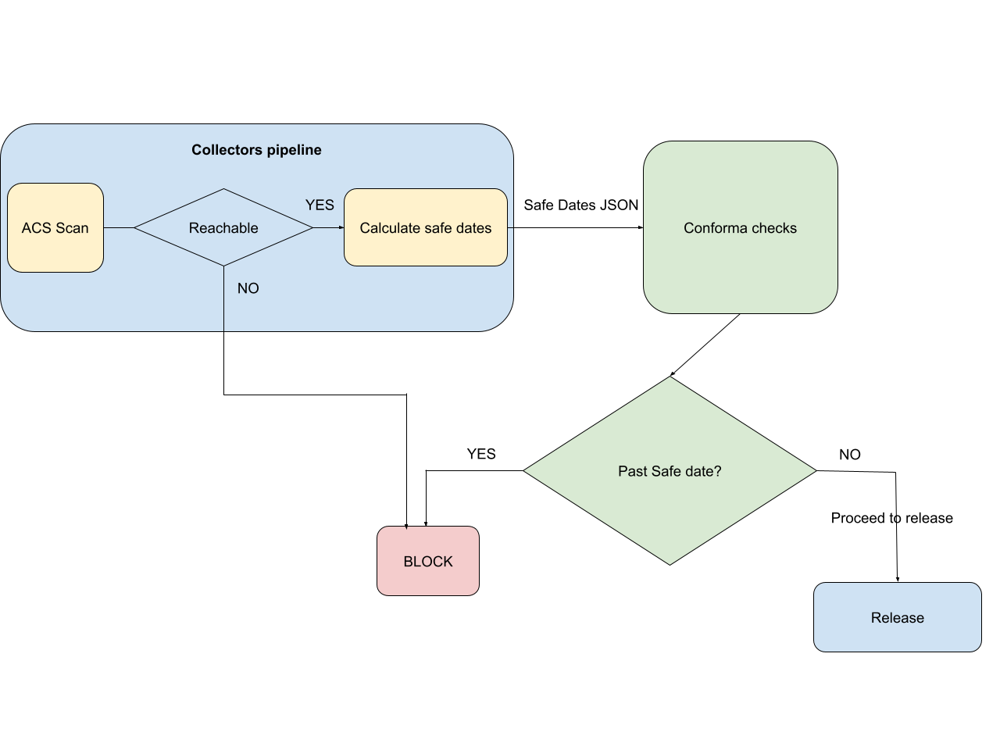

# 72. Include Container grading before release

Date: 2026-10-16

## Status

Proposed

## Context

90.9% of Red Hat container images built in Konflux have vulnerability scanning disabled due to broken legacy functionality. A recent audit found that 22 of 135 container images (16.3%) shipped to customers with known Critical or Important vulnerabilities that had fixes already available. This is a direct security and reputational risk. Manual oversight cannot scale. An automated fix is required.
Important note is that the behavior is expected to be present in two places: integration service, collectors pipeline.
Those differ in many ways from each other, meaning the task implementation will be individual, we can however make an agreement on standardizing things like task-names and result-names.
This ADR is a Phase #1 - No container grading(CG) gating(applies to container-grade-based release gating only, not infrastructure availability issues), task creation, dates evaluation, data representation, policies creation.
Container grading is the result that came from CHI refferenced documents in References section.

## Decision

### Integration-service side

The general idea is to provide a task that is capable of fetching the critical and important vulnerability RHSA, then providing the information about the safe dates(whether it is past due or within it).
Important: Task is optional, it is not requested to be run before release.
The task should be located within the build-definitions pipeline after ACS scan.
ACS scan needs to provide both types of RHSA in a format suitable for next processing.

**Format suggestion**:

```json
{"CRITICAL": ["RHSA-2026:58936","RHSA-2026:52036", "RHSA-2025:58936"],
"IMPORTANT": ["RHSA-2026:55440", "RHSA-2026:55230", "RHSA-2026:55964","RHSA-YYYY:NNNNN"]}
```

**Naming suggestion**:

tekton result: **ACS_RHSAS**

This JSON format is easy to process and interprets data well.

The case might occur where ACS is not available, unable to provide scan output. In this case, we want ACS scan not to fail. Instead provide an error message to the logs and create tekton result **ACS_RHSAS** with following format:

```json
{"ACS_UNREACHABLE":true}
```

calculate-safe-dates will then check for the "ACS_UNREACHABLE" fields first from **ACS_RHSAS**, in case they are detected, provide an error message informing about such fact. calculate-safe-dates must forward {"ACS_UNREACHABLE":true} as its SAFE_DATES result when ACS is unreachable.
Retries for the pipeline will be handled in [KONFLUX-12121](https://redhat.atlassian.net/browse/KONFLUX-12121).


New task **calculate-safe-dates** is expected to be located within a build-definitions pipeline. It receives data (RHSA JSON) from ACS scan, then fetches all the corresponding RHSA release_dates for each one. It then calculates dates on following logic:

**critical_safe_date** = RHSA released_on + 30 days
**important_safe_date** = RHSA released_on + 90 days

The Expected output from this task will be in the tekton **result** data type named **SAFE_DATES**.
**SAFE_DATES** results are only for informational CG estimate for users.

**Format suggestion**:

```json
{"CRITICAL":[{"RHSA-2026:58936":{"released_on":"2026-08-03T14:37:22Z", "safe_until": "2026-09-02T14:37:22Z", "block": true}
 },{"RHSA-2026:52036":{"released_on":"2026-10-03T14:37:22Z", "safe_until": "2026-11-02T14:37:22Z", "block": false}}],

"IMPORTANT":[{"RHSA-2026:55440": {"released_on":"2026-10-01T14:37:22Z", "safe_until": "2026-12-30T14:37:22Z", "block": false}}]}
```

Task is also capable of providing estimated CG for users. There are currently three grades of CG:
**PASS**, **WARN**, **BLOCK**.
Include information about estimated CG based on those grades.
Grades description are following:

- **PASS**: This image does not contain known unapplied errata that fix Critical or Important flaws. Safe dates will look the following way for this case:

For collector-pipeline:

```json
{"<COMPONENT-NAME>":{"CRITICAL":[], "IMPORTANT":[]}}
```

For integration-service:

```json
{"CRITICAL":[], "IMPORTANT":[]}
```

- **WARN**: This image may be missing Critical or Important security errata, provided no missing Critical flaw is older than 30 days and no missing Important flaw is older than 90 days.

- **BLOCK**: This image is missing Critical flaws older than 30 days or Important flaws older than 90 days

Task will provide CG estimation following way:
- Provide info message as the last part of the task/step:
**ESTIMATED CONTAINER GRADE: PASS/WARN/BLOCK**
Estimation in the task/step plays informative role for the user, final evaluation is done by conforma, however the evaluation logic is the same as for the task/step making the info message relevant.

### Collectors-pipeline side

There is a collectors specific pipelinerun definition that runs ACS scan inside **run-collectors**, in the cve collector.

The cve collector emits the complete scan; calculate-safe-dates performs the Critical/Important-with-RHSA selection and the date math. The **SAFE_DATES** result name and shape are standardized with integration-service, but the task inputs differ (full scan on the collectors side vs ACS_RHSAS on the integration side).

Collectors pipeline will run(**mandatory**) for each user before release, integration-service(**optional**) is not required for release.

The case might occur where ACS is not available, unable to provide scan output. In this case, we want collectors pipeline to fail not even reaching Conforma.
Retries for the pipeline will be handled in [KONFLUX-12121](https://redhat.atlassian.net/browse/KONFLUX-12121).

**Format suggestion**:

```json
{"<COMPONENT-NAME>":{"CRITICAL":[{"RHSA-2026:58936":{"released_on":"2026-08-03T14:37:22Z", "safe_until": "2026-09-02T14:37:22Z", "block": true}
 },{"RHSA-2026:52036":{"released_on":"2026-10-03T14:37:22Z", "safe_until": "2026-11-02T14:37:22Z", "block": false}}],

"IMPORTANT":[{"RHSA-2026:55440": {"released_on":"2026-10-01T14:37:22Z", "safe_until": "2026-12-30T14:37:22Z", "block": false}}]}}
```

The implementation approach will be following:
- New task will be added in collectors pipeline, between **run-collectors** and **save-collectors-results**.
- Outputs will be stored in **Release.status.collectors** via **save-collectors-results** made out of compact **SAFE_DATES** result
- Conforma will read from the Release rather than from tekton result

Down below you can see the flowchart representing the proposed solution.




### Conforma side

The key role is to evaluate whether to gate or not. Conforma part in this comes once the task is present and provides all the required information.
Expecting following suggested(only for illustration, can be different in reality) format for the **Release.status.collectors** CRD:

```json
{"<COMPONENT-NAME>":{"CRITICAL":[{"RHSA-2026:58936":{"released_on":"2026-08-03T14:37:22Z", "safe_until": "2026-09-02T14:37:22Z", "block": true}
 },{"RHSA-2026:52036":{"released_on":"2026-10-03T14:37:22Z", "safe_until": "2026-11-02T14:37:22Z", "block": false}}],

"IMPORTANT":[{"RHSA-2026:55440": {"released_on":"2026-10-01T14:37:22Z", "safe_until": "2026-12-30T14:37:22Z", "block": false}}]}}
```

Component-name wrapper is required by conforma, since release can contain multiple components.

### Required logic development

Conforma checks for individual RHSAids values and blocks in case the RHSA is past the date range. Conforma violation(gating) should reflect the reason behind blocking the release(whether RHSA is past date). The situation might occur that during the time of the scan(on integration and collectors side) the RHSA is within a time range, conforma runs afterwards making the date not alligned with current time. This means we require conforma to run the same logic for date evaluation as for previous (integration, collectors) services to make the check most precise.
This does not mean that previous calculations are not valid, it only means we want to provide the most accurate check.
Crutial data are stored under **released_on** key against wthich should run the calculation. Block field is used only for its infromational grade estimate and must be ignored by conforma.
Conforma evaluation should consume **SAFE_DATES** from collectors pipeline only, gating will be enabled for collectors pipeline (phase #2).

Gating decision is made according to the grades described in previous section and the grade itself is computed downstream.
Conforma will create CG gating logic (PASS/WARN/BLOCK evaluation) but will not enable it in Phase #1.


## Consequences

### Positive

- Clear security report at built time
- Informative benefit letting users know if their image release is going to be blocked beforehand

### Negative

- New task to maintain, release
- Upstream inaccessibility to the ACS scan

## References

- [KONFLUX-15693](https://redhat.atlassian.net/browse/KONFLUX-15693) —
  feature Enforce CHI-like rules for container release pipelines
- [STONEINTG-1868](https://issues.redhat.com/browse/STONEINTG-1868) —
  epic Support enforcing CHI based CVE Release Gating
