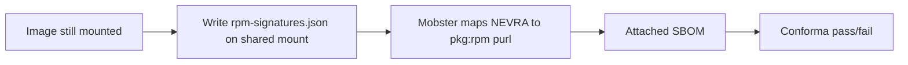

# 72. RPM signature policy via Conforma on the image SBOM

Date: 2026-10-08

## Status

Proposed

## Context

Pipelines today run the **`rpms-signature-scan`** Tekton task after the image build. That task pulls the image, unpacks layers, runs `rpm -qa` again, and writes task results (`TEST_OUTPUT`, `RPMS_DATA`, …) that **Conforma** evaluates.

The build already had the filesystem mounted once. Repeating the extract is expensive (CPU, memory, disk, wall time), and it grows with image size and with every architecture in a matrix. `rpm -qa` is cheap at build time; reconstructing the filesystem from the registry is not.

This ADR **retires `rpms-signature-scan`** task. RPM signature data is collected at build time, stamped into the **companion SBOM** by Mobster, and **Conforma reads that SBOM** to pass or fail the check. No separate scan task.

## Decision

While the output image is still mounted, `konflux-build-cli` writes `rpm-signatures.json` on the shared mount Mobster already uses (same pattern as Syft’s `sbom-image.json`). The path is passed into Mobster as a parameter, alongside the Syft SBOM inputs.

Mobster processing merges that file into the final SBOM:

- **`reason` JSON** — embed the reason on the **SBOM document** (SPDX root `annotations[]` on `SPDXRef-DOCUMENT`; CycloneDX `metadata.properties[]` per [bom-1.5 `metadata`](https://github.com/CycloneDX/specification/blob/master/schema/bom-1.5.schema.json)).
- **`packages` JSON** — for each row, match NEVRA to the Syft **`pkg:rpm`** package (via purl) and stamp every collected signature (`key_id` and `scheme`) on that package per [ADR 0044](0044-spdx-support.md) (`name` / `value` strings; see below).

The published SBOM (attached with `cosign attach sbom` as today) is the **only** artifact Conforma needs for RPM signature policy. Pipelines **remove** the `rpms-signature-scan` task and any wiring to its results.

### Build succeeds; Conforma enforces policy

RPM signature collection is **not** a build gate.

- **`image build` still succeeds** when signature collection fails, when the inventory lists unsigned RPMs, or when only a `reason` can be written. The build does not fail Tekton, block push, or reject the image for those cases.
- Failures and edge cases are **recorded**, not hidden: `konflux-build-cli` writes `rpm-signatures.json` with `{"reason": "…"}` when collection cannot produce a package list; Mobster copies that onto the SBOM document (not the image `pkg:oci` package).
- **Conforma is the authority** for pass or fail. After the snapshot, Conforma policies read the attached SBOM and apply tenant rules (allowed PGP key IDs, unsigned RPMs, missing inventory, operational `reason` strings, cataloger disabled, and so on). A failed signature *policy* is a Conforma/integration outcome, not a failed build step.

Unsigned RPMs in a successful `packages` list are data for policy, not a build error.

### When to run `rpm -qa`

| Condition | Run `rpm -qa`? | Write `rpm-signatures.json`? |
|---|---|---|
| `SKIP_SBOM_GENERATION=true` | No | No — nothing to pass to Mobster |
| Syft RPM cataloger disabled (`-rpm-db-cataloger` in cataloger selection) | No | Yes — `reason` only (see below) |
| Otherwise, SBOM generation enabled | Yes | Yes — `packages` or `reason` from the query |

**Knowing whether the RPM cataloger is disabled, before the query:** The build already passes `--syft-select-catalogers` / `SBOM_SYFT_SELECT_CATALOGERS` into `konflux-build-cli` (same value Syft uses). If that selection includes `-rpm-db-cataloger`, there will be no Syft `pkg:rpm` rows for Mobster to annotate, so the build skips `rpm -qa` and writes the cataloger-disabled `reason` instead. No separate detection step is required beyond reading the same flag the Syft invocation uses.

### RPM database location and `rpm -qa` command

Collection runs in `konflux-build-cli` while the **output image root** is mounted (same mount Syft uses for the image SBOM). The `rpm` binary comes from the **build environment** (`rpm` on `PATH` in the task container), not from executables inside the mount.

#### Locate the database directory

Under `<mount>` (the image root), search these **relative** directories **in order**. The first directory that contains at least one **regular** database file wins:

| Order | Path under `<mount>` | Notes |
| --- | --- | --- |
| 1 | `usr/lib/sysimage/rpm` | RHEL 10, bootc, and OSTree images keep the live SQLite DB here. |
| 2 | `var/lib/rpm` | Traditional layout; on RHEL 10 this may be a symlink to `usr/lib/sysimage/rpm` or a leftover stub—so it is not checked first. |
| 3 | `usr/share/rpm` | Fallback when neither path above has a DB. |

A directory qualifies if any of these files exist as a regular file: `rpmdb.sqlite`, `Packages`, or `Packages.db`.

If no directory qualifies, write `{"reason": "No RPM database in image"}` and do not run `rpm -qa`.

#### Collection order

1. Resolve `<rpmdb-dir>` with the table above (`<mount>/usr/lib/sysimage/rpm`, etc.).
2. If `rpm` is not on `PATH`, write `{"reason": "failed to get rpm signatures - rpm not found in PATH"}`.
3. Run `rpm -qa` with `--dbpath` set to `<rpmdb-dir>` (absolute path on the host).
4. On non-zero exit or unusable query output, write `{"reason": "failed to get rpm signatures - <err>"}` where `<err>` is exit status and/or trimmed `stderr` from `rpm -qa` (same wrapped form as the reason table below).
5. If the query returns no installable rows after skipping `gpg-pubkey`, write `{"reason": "RPM database is empty"}`.
6. Otherwise build the `packages` list for `rpm-signatures.json`.

#### Query command

Five **tab-separated** fields per package: `NAME`, `EPOCH`, `VERSION-RELEASE`, `ARCH`, and **all** OpenPGP signature lines for that RPM. Epoch is its own column (`(none)` when unset); when building NEVRA, prefix `VERSION-RELEASE` with `EPOCH:` only if epoch is set and not `(none)`. The fifth field uses rpm **array expansion** `[%{OPENPGP:pgpsig}\n]` so every signature on the package is emitted (classic RSA/DSA and [PQC](https://developers.redhat.com/articles/2025/10/07/signing-rpm-packages-using-quantum-resistant-cryptography#signing_rpm_software); see [RPM v6 signatures](https://rpm-software-management.github.io/rpm/manual/format_v6.html#signature)). A bare `%{OPENPGP:pgpsig}` returns only the **first** signature; `%{RSAHEADER:pgpsig}` / `%{DSAHEADER:pgpsig}` are scalar headers and omit additional OPENPGP signatures. Do not use rpm’s `%|TAG?{…}:…|` ternary with extra `:` inside the branches (rpm 4.19 can treat that as a format error, exit 0, and return empty stdout).

```bash
rpm -qa --dbpath "<rpmdb-dir>" --qf \
  '%{NAME}\t%{EPOCH}\t%{VERSION}-%{RELEASE}\t%{ARCH}\t[%{OPENPGP:pgpsig}\n]\n'
```

Replace `<rpmdb-dir>` with the chosen directory (for example `<mount>/usr/lib/sysimage/rpm`).

Example with `<mount>` = `/tmp/build-mount`:

```bash
rpm -qa --dbpath "/tmp/build-mount/usr/lib/sysimage/rpm" --qf \
  '%{NAME}\t%{EPOCH}\t%{VERSION}-%{RELEASE}\t%{ARCH}\t[%{OPENPGP:pgpsig}\n]\n'
```

**Stdout shape:** the first line for each package has four tabs; further pgpsig lines for the same package continue on following lines **without** tabs. The trailing `\n` after `[%{OPENPGP:pgpsig}\n]` prints a **blank line** between packages (ignore empty lines when parsing). Example (`gzip` on RHEL 10 bootc, dual-signed):

```text
gzip	(none)	1.13-4.el10_2	x86_64	RSA/SHA256, Thu Aug 27 12:24:35 2026, Key ID 199e2f91fd431d51
ML-DSA-87+Ed448/SHA512, Thu Aug 27 12:24:36 2026, Key ID fcd355b305707a62

setup	(none)	2.14.5-7.el10	noarch	RSA/SHA256, Mon May 26 10:39:00 2025, Key ID 199e2f91fd431d51
```

`konflux-build-cli` groups tabbed lines and continuations into one row per package before building `signatures` (`key_id` and `scheme` per pgpsig line).

### `rpm-signatures.json` (hand-off to Mobster)

The file is either a **`packages` list** or a **`reason`**, never both. It is not published as its own OCI artifact; Mobster consumes it during `generate oci-image`.

#### Success — installed RPMs with signatures

`gpg-pubkey` rows are skipped. `name` is NEVRA (`NAME-[EPOCH:]VERSION-RELEASE.ARCH`). `signatures` lists every signature on the package from the query above, in query order:

| Field | Source |
| --- | --- |
| `key_id` | Hex digits after `Key ID` on the pgpsig line (typically the **64-bit “long” key ID**, 16 hex characters on RHEL), lowercased; not the OpenPGP fingerprint (40/64 hex). |
| `scheme` | Text before the first comma on the same line (for example `RSA/SHA256`, `ML-DSA-87+Ed448/SHA512`). |

Duplicate `(key_id, scheme)` pairs are dropped. When there is no signature (`(none)` or no parseable pgpsig line), use a single entry `{"key_id": "unsigned", "scheme": ""}`.

```json
{
  "packages": [
    {
      "name": "bash-5.2.26-6.el10.x86_64",
      "signatures": [
        {"key_id": "199e2f91fd431d51", "scheme": "RSA/SHA256"}
      ]
    },
    {
      "name": "gzip-1.13-4.el10_2.x86_64",
      "signatures": [
        {"key_id": "199e2f91fd431d51", "scheme": "RSA/SHA256"},
        {"key_id": "fcd355b305707a62", "scheme": "ML-DSA-87+Ed448/SHA512"}
      ]
    }
  ]
}
```

Mobster maps each `name` to the matching Syft `pkg:rpm` entry (NEVRA ↔ purl, including epoch when present) and adds **one** SBOM stamp on that package per [ADR 0044](0044-spdx-support.md): `name` `rpm:pgp-signatures` and `value` set to the **JSON serialization (string)** of the full `signatures` array from `rpm-signatures.json` (all OPENPGP-derived entries, including dual RSA + PQC). SPDX JSON-encodes the `name` / `value` pair into `annotations[].comment` with `annotator` `Tool: konflux-ci:rpm-signature:jsonencoded`; CycloneDX uses the same `name` and string `value` on the component’s `properties[]`.

#### Reason — no inventory to attach per package

`packages` is omitted:

```json
{"reason": "<message>"}
```

Mobster embeds the reason on the **SBOM document** only. None of these rows fail the build; they exist so Conforma can evaluate the SBOM later.

| When | Example `reason` | Mobster target |
|---|---|---|
| Signature collection failed (`rpm` missing, `rpm -qa` error, mount error, etc.) | `failed to get rpm signatures - <err>` (e.g. `rpm not found in PATH`, exit status + stderr from `rpm -qa`) | SPDX document `annotations[]`; CycloneDX `metadata.properties[]` |
| No rpmdb in the mount | `No RPM database in image` | Same |
| rpmdb present, zero installed packages | `RPM database is empty` | Same |
| RPM cataloger disabled in Syft (no `pkg:rpm` rows to annotate) | `RPM Cataloger is disabled by Syft` | Same |

### Conforma evaluation (replaces `rpms-signature-scan`)

Conforma reads the **attached SBOM** per architecture when applicable and applies **policy** to the RPM signature data Mobster stamped there. The build only supplies honest SBOM content; Conforma decides whether the snapshot passes or fails. Structures Conforma may read:

- **Document-level `reason`** — SPDX root `annotations[]` (JSON-encoded `name` / `value` in `comment`, annotator `Tool: …:jsonencoded` per [ADR 0044](0044-spdx-support.md)) or CycloneDX `metadata.properties[]` (`name` `rpm:pgp-stamp-reason`); evaluate operational failures, empty or missing rpmdb, and cataloger-disabled cases without scanning the full package list.

- **Per-RPM stamps on `pkg:rpm`** — enforce allowed `key_id` values (and optionally `scheme`); treat `key_id`: `unsigned` like today’s unsigned RPM count; fail the policy when rules are violated.

  **SBOM encoding ([ADR 0044](0044-spdx-support.md)):** Document-level `reason` and per-RPM `rpm:pgp-signatures` both use `{"name": <string>, "value": <string>}`. SPDX JSON-encodes that object into `annotations[].comment` with `annotator` `Tool: konflux-ci:rpm-signature:jsonencoded`; CycloneDX stores the same `name` and string `value` on `properties[]` (document metadata for `reason`; matching **`pkg:rpm` component** for signatures). Each SPDX annotation must include SPDX 2.3–required fields (`annotationDate`, `annotationType`, `annotator`, `comment`). Conforma locates stamps per format (root vs package `annotations[]` vs `metadata.properties[]` vs component `properties[]`), then applies the same logic to the decoded `name` / `value` pair.

  After Mobster processing, a dual-signed `gzip` row looks like the following (SPDX 2.3; illustrative package object from the final image SBOM):

  ```json
  {
    "SPDXID": "SPDXRef-Package-rpm-gzip-a1b2c3d4e5f6",
    "name": "gzip",
    "versionInfo": "1.13-4.el10_2",
    "downloadLocation": "NOASSERTION",
    "filesAnalyzed": false,
    "licenseConcluded": "NOASSERTION",
    "licenseDeclared": "NOASSERTION",
    "copyrightText": "NOASSERTION",
    "supplier": "Organization: Red Hat",
    "originator": "Organization: Red Hat",
    "sourceInfo": "acquired package info from RPM DB: /usr/lib/sysimage/rpm/rpmdb.sqlite",
    "externalRefs": [
      {
        "referenceCategory": "PACKAGE-MANAGER",
        "referenceType": "purl",
        "referenceLocator": "pkg:rpm/redhat/gzip@1.13-4.el10_2?arch=x86_64&distro=rhel-10.2"
      }
    ],
    "annotations": [
      {
        "annotationDate": "2026-03-20T12:00:00Z",
        "annotationType": "OTHER",
        "annotator": "Tool: konflux-ci:rpm-signature:jsonencoded",
        "comment": "{\"name\": \"rpm:pgp-signatures\", \"value\": \"[{\\\"key_id\\\": \\\"199e2f91fd431d51\\\", \\\"scheme\\\": \\\"RSA/SHA256\\\"}, {\\\"key_id\\\": \\\"fcd355b305707a62\\\", \\\"scheme\\\": \\\"ML-DSA-87+Ed448/SHA512\\\"}]\"}"
      }
    ]
  }
  ```

  Decoded `comment` payload (same `name` / string `value` as CycloneDX `properties[]` for that package):

  ```json
  {
    "name": "rpm:pgp-signatures",
    "value": "[{\"key_id\":\"199e2f91fd431d51\",\"scheme\":\"RSA/SHA256\"},{\"key_id\":\"fcd355b305707a62\",\"scheme\":\"ML-DSA-87+Ed448/SHA512\"}]"
  }
  ```

  Conforma matches `pkg:rpm` packages (by purl / NEVRA), reads the `name` / `value` pair (decode SPDX `comment` or read CycloneDX `properties[]`), parses `value` as JSON to obtain `[{key_id, scheme}, …]`. A single-signature package has a one-element array; unsigned RPMs use a one-element array with `key_id` `unsigned` and empty `scheme` inside the string.

  **CycloneDX** (no checked-in Mobster-processed CycloneDX SBOM yet — shape from build/Mobster design): one component property with the **same** string `value`:

  ```json
  {
    "type": "library",
    "name": "gzip",
    "version": "1.13-4.el10_2",
    "purl": "pkg:rpm/redhat/gzip@1.13-4.el10_2?arch=x86_64&distro=rhel-10.2",
    "properties": [
      {
        "name": "rpm:pgp-signatures",
        "value": "[{\"key_id\":\"199e2f91fd431d51\",\"scheme\":\"RSA/SHA256\"},{\"key_id\":\"fcd355b305707a62\",\"scheme\":\"ML-DSA-87+Ed448/SHA512\"}]"
      }
    ]
  }
  ```

  SPDX encodes NEVRA in the package identity; CycloneDX relies on `purl` (and name/version) on the same component.

- **Document-level reason `No RPM database in image` or `RPM database is empty`** — no RPMs to judge; policy may pass (equivalent to zero unsigned).

  Conforma and policy tooling can read these without scanning `packages[]` / `components[]`. SPDX mirrors CycloneDX `name` / `value` by JSON-encoding the pair into `comment` ([ADR 0044](0044-spdx-support.md)); CycloneDX uses [BOM `metadata.properties`](https://github.com/CycloneDX/specification/blob/master/schema/bom-1.5.schema.json) (document metadata, not `metadata.component`).

  **SPDX 2.3** — root document (`SPDXRef-DOCUMENT`); excerpt:

  ```json
  {
    "SPDXID": "SPDXRef-DOCUMENT",
    "spdxVersion": "SPDX-2.3",
    "annotations": [
      {
        "annotationDate": "2026-03-20T12:00:00Z",
        "annotationType": "OTHER",
        "annotator": "Tool: konflux-ci:rpm-signature:jsonencoded",
        "comment": "{\"name\": \"rpm:pgp-stamp-reason\", \"value\": \"No RPM database in image\"}"
      }
    ]
  }
  ```

  **CycloneDX 1.5** — `metadata.properties` on the BOM (same `name` / `value` as the JSON inside SPDX `comment`):

  ```json
  {
    "bomFormat": "CycloneDX",
    "specVersion": "1.5",
    "metadata": {
      "properties": [
        {
          "name": "rpm:pgp-stamp-reason",
          "value": "No RPM database in image"
        }
      ]
    }
  }
  ```

  `RPM database is empty` uses the same encoding with SPDX `value` in the JSON `comment` and CycloneDX `metadata.properties[].value`: `RPM database is empty`.

- **Document-level reason `RPM Cataloger is disabled by Syft`** — defined in Conforma policy (no per-RPM stamps in SBOM; pipelines that disable the cataloger accept that trade-off).
- **Document-level reason `failed to get rpm signatures - …`** — operational failure at build time; the image may still have been built and pushed. Conforma policy typically **fails** here (same intent as a failed `rpms-signature-scan`), but that is a policy decision, not `image build` exiting non-zero.

Exact Rego or policy names live in enterprise-contract; this ADR only fixes the data location (SBOM), separates build success from policy enforcement, and removes the Tekton scan step.

### Work order

1. **konflux-build-cli** — while mounted, apply the table above; write `rpm-signatures.json` on the shared mount when SBOM generation is enabled.
2. **Mobster** — accept the file path; stamp `reason` or per-RPM `rpm:pgp-signatures` on the SBOM per [ADR 0044](0044-spdx-support.md) (string `value`; stringify `signatures` from `rpm-signatures.json`).
3. **Conforma / enterprise-contract** — policies that read SBOM RPM signature fields; migrate off `RPMS_DATA` from `rpms-signature-scan`.
4. **Pipelines** — drop `rpms-signature-scan` from build definitions; deprecate or remove the task in tekton-tools when consumers are migrated ([ADR 0054](0054-task-versioning.md) for task lifecycle).



### Rollout

Implementation in **konflux-build-cli**, **Mobster**, and **Conforma** does not require pipeline changes. Pipelines may keep **`rpms-signature-scan`** and existing Conforma rules on Tekton results (`RPMS_DATA`, `TEST_OUTPUT`) until the SBOM path is verified end-to-end.

1. **Build out the SBOM path (scan still authoritative)** — Ship cli → Mobster → Conforma in any order that respects the work order above. The Tekton task continues to gate releases; new code only adds `rpm-signatures.json`, stamps on the attached SBOM, and Conforma logic that can read those fields (initially non-blocking for release if policy is configured that way).

2. **End-to-end validation** — Before relying on the SBOM for policy, confirm on representative images (including multi-arch): build writes `rpm-signatures.json` on the shared mount when SBOM generation is enabled → Mobster merges it into the **cosign-attached** SBOM per architecture → Conforma can read per-RPM stamps, document-level `reason`, and the edge cases in the tables above. Images built before this tooling shipped have **no** RPM signature fields on the SBOM; they remain covered by the scan task until re-built.

3. **Dual-run and compare** — For a bounded period, run **`rpms-signature-scan` alongside** the SBOM-based Conforma evaluation. Compare outcomes per architecture: NEVRA inventory (allowing for `gpg-pubkey` omitted at build time), `key_id` / `scheme` per package, `unsigned` counts, and alignment when only a document-level `reason` is present. Discrepancies are triaged before cutover.

4. **Enforce SBOM, then remove the scan** — When comparison is satisfactory, Conforma **enforces** RPM signature policy from the attached SBOM (same pass/fail intent as today’s scan). Optionally keep the Tekton task running briefly so both must pass, then remove `rpms-signature-scan` from each pipeline definition. Deprecate or delete the task in tekton-tools when no consumers remain ([ADR 0054](0054-task-versioning.md)).

Until step 4 completes, **`rpms-signature-scan` remains the contract** for pipelines that have not migrated. After cutover, the attached SBOM is the only artifact Conforma needs for this check, as stated in the Decision.

## Alternatives Considered

**Keep `rpms-signature-scan`.** Would preserve Tekton results unchanged, but every pipeline would still pay for image extract and a dedicated task after build. Rejected now that signature data lives on the SBOM Conforma already consumes.

**Keep extracting the image in a scan task.** Same cost as today; rejected for the same reason as the original ADR.

**Publish a separate build-time sibling OCI artifact** (for example `{repo}:sha256-<digest>.rpmsig` plus a Tekton result such as `RPMSIG_BLOB_URL`). Adds registry and result surface area and splits inventory away from the SBOM. Rejected.

## Consequences

Pipelines lose a post-build Tekton task and the associated pull/unpack cost. **Conforma becomes the sole gate** for RPM signature rules on the SBOM; the build records signatures or `reason` and does not treat signature problems as build failures. Signature data depends on SBOM generation (`SKIP_SBOM_GENERATION` off) and, for per-package stamps, on Syft emitting `pkg:rpm` packages (RPM cataloger not disabled). Disabling the RPM cataloger avoids `rpm -qa` but records an image-level reason instead of per-RPM signatures in the SBOM. Migration requires Conforma policies that read the SBOM (including failure reasons) and removing `rpms-signature-scan` from each pipeline before the task can be deleted from the catalog.
