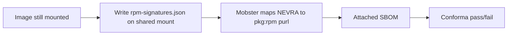

# 72. RPM signature policy via Conforma on the image SBOM

Date: 2026-10-08

## Status

Proposed

## Context

Pipelines today run the **`rpms-signature-scan`** Tekton task after the image build. That task pulls the image, unpacks layers, runs `rpm -qa` again, and writes task results (`TEST_OUTPUT`, `RPMS_DATA`, …) that **Conforma** evaluates.

The build already had the filesystem mounted once. Repeating the extract is expensive (CPU, memory, disk, wall time), and it grows with image size and with every architecture in a matrix. `rpm -qa` is cheap at build time; reconstructing the filesystem from the registry is not.

This ADR **retires `rpms-signature-scan`** task. RPM signature data is collected at build time, stamped into the **companion SBOM** by Mobster, and **Conforma reads that SBOM** to pass or fail the check. No separate scan task.

## Decision

While the output image is still mounted, `konflux-build-cli` writes `rpm-signatures.json` on the shared mount Mobster already uses (same pattern as Syft’s `sbom-image.json`). The path is passed into Mobster as a parameter, alongside the Syft SBOM inputs.

Mobster processing merges that file into the final SBOM:

- **`reason` JSON** — embed the reason **code** on the **SBOM document** (SPDX root `annotations[]` on `SPDXRef-DOCUMENT`; CycloneDX `metadata.properties[]` per [bom-1.5 `metadata`](https://github.com/CycloneDX/specification/blob/master/schema/bom-1.5.schema.json)). Optional diagnostic text is a separate property and is not what policy matches.
- **`packages` JSON** — for each row, match NEVRA to every **`pkg:rpm`** component in the SBOM Mobster is writing (Hermeto and Syft, via the comparison below) and stamp the same signatures (`key_id` and `scheme`) on each match per [ADR 0044](0044-spdx-support.md) (`name` / `value` strings; see below). Also set document property `konflux:rpm:collected` to the string `true`. Syft’s RPM cataloger being disabled does not skip collection: Hermeto can still report the installed RPMs.

Every SBOM Mobster processes for this check has `konflux:rpm:collected` or `konflux:rpm:stamp-reason`. A `packages` file sets `konflux:rpm:collected`. A `reason` file sets `konflux:rpm:stamp-reason`. If SBOM generation is enabled and `rpm-signatures.json` is missing, unreadable, or the path is empty, Mobster writes `konflux:rpm:stamp-reason` `COLLECTION_FAILED`.

The published SBOM (attached with `cosign attach sbom` as today) is the **only** artifact Conforma needs for RPM signature policy. Pipelines **remove** the `rpms-signature-scan` task and any wiring to its results.

### Build succeeds; Conforma enforces policy

RPM signature collection is **not** a build gate.

- **`image build` still succeeds** when signature collection fails, when the inventory lists unsigned RPMs, or when only a `reason` can be written. The build does not fail Tekton, block push, or reject the image for those cases.
- Failures and edge cases are **recorded**, not hidden: `konflux-build-cli` writes `rpm-signatures.json` with a `reason` object (`code` plus optional `detail`) when collection cannot produce a package list; Mobster copies the **code** onto the SBOM document (not the image `pkg:oci` package).
- **Conforma is the authority** for pass or fail. Passing or failing the RPM signature check is entirely up to Conforma and the policies it applies. After the snapshot, those policies read the attached SBOM and apply tenant rules (allowed PGP key IDs, unsigned RPMs, missing inventory, missing collection evidence, reason **codes**, unmatched NEVRAs, and so on). A failed signature *policy* is a Conforma/integration outcome, not a failed build step. Policy compares reason **codes** with equality. It does not match free-form text.

Unsigned RPMs in a successful `packages` list are data for those policies, not a build error.

### When to run `rpm -qa`

| Condition | Run `rpm -qa`? | Write `rpm-signatures.json`? |
|---|---|---|
| `SKIP_SBOM_GENERATION=true` | No | No — nothing to pass to Mobster |
| Otherwise, SBOM generation enabled | Yes | Yes — `packages` or `reason` from the query |

Syft cataloger selection (`--syft-select-catalogers` / `SBOM_SYFT_SELECT_CATALOGERS`, including `-rpm-db-cataloger`) does **not** decide whether to run `rpm -qa`. The installed set comes from the image rpmdb. The SBOM package list Mobster stamps onto may come from Hermeto, from Syft, or from both. If Syft emits no `pkg:rpm` rows, Hermeto rows can still receive stamps. NEVRAs that match nothing are recorded by Mobster (see below); the build does not skip the query to avoid that case.

### RPM database location and `rpm -qa` command

Collection runs in `konflux-build-cli` while the **output image root** is mounted (same mount Syft uses for the image SBOM). The `rpm` binary comes from the **build environment** (`rpm` on `PATH` in the task container), not from executables inside the mount.

#### Locate the database directory

Under `<mount>` (the image root), search these **relative** directories **in order**. The first directory that contains at least one **regular** database file wins:

| Order | Path under `<mount>` | Notes |
| --- | --- | --- |
| 1 | `usr/lib/sysimage/rpm` | RHEL 10, bootc, and OSTree images keep the live SQLite DB here. |
| 2 | `var/lib/rpm` | Traditional layout; on RHEL 10 this may be a symlink to `usr/lib/sysimage/rpm` or a leftover stub—so it is not checked first. |
| 3 | `usr/share/rpm` | Fallback when neither path above has a DB. |

A directory qualifies if any of these files exist as a regular file: `rpmdb.sqlite`, `Packages`, or `Packages.db`.

If no directory qualifies, write `{"reason": {"code": "NO_RPM_DATABASE"}}` and do not run `rpm -qa`.

#### Collection order

1. Resolve `<rpmdb-dir>` with the table above (`<mount>/usr/lib/sysimage/rpm`, etc.).
2. If `rpm` is not on `PATH`, write `{"reason": {"code": "COLLECTION_FAILED", "detail": "rpm not found in PATH"}}`.
3. Run `rpm -qa` with `--dbpath` set to `<rpmdb-dir>` (absolute path on the host).
4. On non-zero exit or unusable query output, write `{"reason": {"code": "COLLECTION_FAILED", "detail": "<err>"}}` where `<err>` is exit status and/or trimmed `stderr` from `rpm -qa`.
5. If the query returns no installable rows after skipping `gpg-pubkey`, write `{"reason": {"code": "RPM_DATABASE_EMPTY"}}`.
6. Otherwise build the `packages` list for `rpm-signatures.json`.

`code` is one of the constants in the reason table below. `detail` is optional diagnostic text. Omit `detail` when there is nothing to add. Conforma must not branch on `detail`.

#### Query command

Five **tab-separated** fields per package: `NAME`, `EPOCH`, `VERSION-RELEASE`, `ARCH`, and **all** OpenPGP signature lines for that RPM. Epoch is its own column (`(none)` when unset); when building NEVRA, prefix `VERSION-RELEASE` with `EPOCH:` only if epoch is set and not `(none)`. Epoch `0` is set, so the NEVRA includes `0:`. The fifth field uses rpm **array expansion** `[%{OPENPGP:pgpsig}\n]` so every signature on the package is emitted (classic RSA/DSA and [PQC](https://developers.redhat.com/articles/2025/10/07/signing-rpm-packages-using-quantum-resistant-cryptography#signing_rpm_software); see [RPM v6 signatures](https://rpm-software-management.github.io/rpm/manual/format_v6.html#signature)). A bare `%{OPENPGP:pgpsig}` returns only the **first** signature; `%{RSAHEADER:pgpsig}` / `%{DSAHEADER:pgpsig}` are scalar headers and omit additional OPENPGP signatures. Do not use rpm’s `%|TAG?{…}:…|` ternary with extra `:` inside the branches (rpm 4.19 can treat that as a format error, exit 0, and return empty stdout).

```bash
rpm -qa --dbpath "<rpmdb-dir>" --qf \
  '%{NAME}\t%{EPOCH}\t%{VERSION}-%{RELEASE}\t%{ARCH}\t[%{OPENPGP:pgpsig}\n]\n'
```

Replace `<rpmdb-dir>` with the chosen directory (for example `<mount>/usr/lib/sysimage/rpm`).

Example with `<mount>` = `/tmp/build-mount`:

```bash
rpm -qa --dbpath "/tmp/build-mount/usr/lib/sysimage/rpm" --qf \
  '%{NAME}\t%{EPOCH}\t%{VERSION}-%{RELEASE}\t%{ARCH}\t[%{OPENPGP:pgpsig}\n]\n'
```

**Stdout shape:** the first line for each package has four tabs; further pgpsig lines for the same package continue on following lines **without** tabs. The trailing `\n` after `[%{OPENPGP:pgpsig}\n]` prints a **blank line** between packages (ignore empty lines when parsing). Example (`gzip` on RHEL 10 bootc, dual-signed):

```text
gzip	(none)	1.13-4.el10_2	x86_64	RSA/SHA256, Thu Aug 27 12:24:35 2026, Key ID 199e2f91fd431d51
ML-DSA-87+Ed448/SHA512, Thu Aug 27 12:24:36 2026, Key ID fcd355b305707a62

setup	(none)	2.14.5-7.el10	noarch	RSA/SHA256, Mon May 26 10:39:00 2025, Key ID 199e2f91fd431d51
```

`konflux-build-cli` groups tabbed lines and continuations into one row per package before building `signatures` (`key_id` and `scheme` per pgpsig line).

### `rpm-signatures.json` (hand-off to Mobster)

The file is either a **`packages` list** or a **`reason`**, never both. It is not published as its own OCI artifact; Mobster consumes it during `generate oci-image`.

#### Success — installed RPMs with signatures

`gpg-pubkey` rows are skipped. `name` is NEVRA (`NAME-[EPOCH:]VERSION-RELEASE.ARCH`). `(none)` is omitted. Epoch `0` is included as `0:`. `signatures` lists every signature on the package from the query above, in query order:

| Field | Source |
| --- | --- |
| `key_id` | Hex digits after `Key ID` on the pgpsig line (typically the **64-bit “long” key ID**, 16 hex characters on RHEL), lowercased; not the OpenPGP fingerprint (40/64 hex). |
| `scheme` | Text before the first comma on the same line (for example `RSA/SHA256`, `ML-DSA-87+Ed448/SHA512`). |

Duplicate `(key_id, scheme)` pairs are dropped. When there is no signature (`(none)` or no parseable pgpsig line), the `signatures` array is exactly one entry, `{"key_id": "unsigned", "scheme": ""}`. That sentinel is the whole array: do not emit `unsigned` alongside a real `key_id`.

```json
{
  "packages": [
    {
      "name": "bash-5.2.26-6.el10.x86_64",
      "signatures": [
        {"key_id": "199e2f91fd431d51", "scheme": "RSA/SHA256"}
      ]
    },
    {
      "name": "gzip-1.13-4.el10_2.x86_64",
      "signatures": [
        {"key_id": "199e2f91fd431d51", "scheme": "RSA/SHA256"},
        {"key_id": "fcd355b305707a62", "scheme": "ML-DSA-87+Ed448/SHA512"}
      ]
    }
  ]
}
```

Mobster maps each `name` to every matching **`pkg:rpm`** component in the SBOM it is writing (Hermeto, Syft, or both) and stamps each match with the same signatures array. Read the component from its `pkg:rpm` purl (SPDX `externalRefs` or CycloneDX `purl`). Compare name, epoch, version, release, and arch. Version and release are the single `VERSION-RELEASE` string: the NEVRA segment after the optional epoch, and the purl version. Arch is the NEVRA suffix and the purl `arch` qualifier. Epoch in the NEVRA is the `N:` prefix; on the purl it is the `epoch` qualifier. Ignore purl namespace and distro. Epoch `(none)` and a missing epoch qualifier are equal. Epoch `0` is equal only to `epoch=0`. Each matching component gets **one** SBOM stamp per [ADR 0044](0044-spdx-support.md): `name` `konflux:rpm:pgp-signatures` and `value` set to the **JSON serialization (string)** of the full `signatures` array from `rpm-signatures.json` (all OPENPGP-derived entries, including dual RSA + PQC). SPDX JSON-encodes the `name` / `value` pair into `annotations[].comment` with `annotator` `Tool: konflux-ci:rpm-signature:jsonencoded`; CycloneDX uses the same `name` and string `value` on the component’s `properties[]`. The `konflux:` prefix matches other Mobster properties (for example `konflux:container:*`).

Not every `pkg:rpm` receives this property. Hermeto reports RPMs used only at build time that are not installed in the final image, so they have no rpmdb row and no stamp. **Conforma ignores `pkg:rpm` packages that lack `konflux:rpm:pgp-signatures`.** Absence on one component is not `unsigned` and is not a policy failure. The document still has `konflux:rpm:collected` when a `packages` file was applied.

Whenever the hand-off file has `packages`, Mobster sets document property `konflux:rpm:collected` to the string `true`, including when some NEVRAs are unmatched. Omit `konflux:rpm:stamp-reason` on this path. The hand-off file is still `packages` or `reason`, never both.

If a `packages[].name` matches no `pkg:rpm` under that comparison, Mobster still stamps every matching component of every NEVRA that does match, each with that NEVRA’s signatures array. It also adds one **document-level** property, `konflux:rpm:unmatched-nevras`, whose `value` is the JSON serialization (string) of the unmatched NEVRA array, in input order. Omit that property when every NEVRA matched. This is not a `reason`: the hand-off file still has `packages`, and `konflux:rpm:collected` is still set. Conforma must not treat those NEVRAs as verified. When the property is present, policy treats it as an inventory problem (signatures were collected and not attached) and **fails**, same intent as `COLLECTION_FAILED`.

#### Reason — no inventory to attach per package

`packages` is omitted. `reason.code` is a **closed enum**. Implementations define these identifiers as constants (for example Go `const`, Python `Final`, Rego string constants) and compare them with equality. Wording, spelling, and `detail` are not part of the contract. Adding, removing, or renaming a code is an ADR change.

```json
{"reason": {"code": "NO_RPM_DATABASE"}}
```

```json
{"reason": {"code": "COLLECTION_FAILED", "detail": "rpm not found in PATH"}}
```

| `reason.code` | When | `detail` |
|---|---|---|
| `COLLECTION_FAILED` | Signature collection failed (`rpm` missing, `rpm -qa` error, mount error, unusable query output) | Optional. Exit status, trimmed stderr, or a short cause such as `rpm not found in PATH`. |
| `NO_RPM_DATABASE` | No qualifying rpmdb directory in the mount | Omit |
| `RPM_DATABASE_EMPTY` | rpmdb present, zero installable packages after skipping `gpg-pubkey` | Omit |

Mobster embeds the code on the **SBOM document** only, as property `konflux:rpm:stamp-reason` with `value` equal to `reason.code` (a bare constant, not a sentence). When `detail` is present, Mobster also sets `konflux:rpm:stamp-reason-detail` to that string. Omit `konflux:rpm:collected` on this path. None of these rows fail the build; Conforma reads the code later. Do not substring-match `detail` or any previous prose reason (`No RPM database in image`, `failed to get rpm signatures - …`, and so on).

If SBOM generation is enabled and `rpm-signatures.json` is missing, unreadable, or the path is empty, there is no hand-off file to copy. Mobster still writes `konflux:rpm:stamp-reason` `COLLECTION_FAILED` and `konflux:rpm:stamp-reason-detail` `rpm-signatures.json not found`. Do not set `konflux:rpm:collected`.

### Conforma evaluation (replaces `rpms-signature-scan`)

Conforma reads the **attached SBOM** per architecture when applicable and applies **policy** to the RPM signature data Mobster stamped there. The build only supplies honest SBOM content. Passing or failing this check is entirely up to Conforma and the policies it applies; this ADR defines the data those policies read and does not itself accept or reject the image. Structures Conforma may read:

- **Document-level reason code** — SPDX root `annotations[]` (JSON-encoded `name` / `value` in `comment`, annotator `Tool: …:jsonencoded` per [ADR 0044](0044-spdx-support.md)) or CycloneDX `metadata.properties[]` (`name` `konflux:rpm:stamp-reason`). `value` is exactly one reason code. Compare it to the constants above. `konflux:rpm:stamp-reason-detail`, when present, is diagnostic only. Use this path for `COLLECTION_FAILED`, `NO_RPM_DATABASE`, and `RPM_DATABASE_EMPTY` without scanning the package list. There is no cataloger-disabled code. This property is absent when `konflux:rpm:collected` is present.

- **Document-level collection marker** — `konflux:rpm:collected` with value `true` when Mobster applied a `packages` file. Same document encoding as `konflux:rpm:stamp-reason`. It may appear together with `konflux:rpm:unmatched-nevras`. It does not appear together with `konflux:rpm:stamp-reason`.

- **No collection evidence** — an enforcing policy fails when the image SBOM has neither `konflux:rpm:stamp-reason` nor `konflux:rpm:collected`. That is an SBOM this tooling did not stamp (an image built before collection shipped, or a Mobster run that never recorded the hand-off). A single `pkg:rpm` without `konflux:rpm:pgp-signatures` stays ignored when `konflux:rpm:collected` is present.

- **Document-level unmatched NEVRAs** — `konflux:rpm:unmatched-nevras` on the document when Mobster could not attach every collected NEVRA. `konflux:rpm:collected` is also set. Policy **fails** when this property is present.

- **Per-RPM stamps on `pkg:rpm`** — only packages that have `konflux:rpm:pgp-signatures`. Skip `pkg:rpm` packages that do not have the property (build-time RPMs that are not in the final image). Conforma counts distinct NEVRAs under the comparison above. Hermeto and Syft components stamped with the same array for one NEVRA count once.

  A package is unsigned only when `signatures` is exactly `[{"key_id": "unsigned", "scheme": ""}]`. Collection writes `key_id` `unsigned` only as that sole entry, so a list that contains `unsigned` is an unsigned package. A policy that rejects unsigned RPMs fails that package. Every other entry is a real key ID (one or more, including a dual RSA + PQC signature). `scheme` is optional; policies match `key_id`. Which key IDs are allowed is a policy choice. Passing or failing on that choice is up to the policies Conforma runs.

  **SBOM encoding ([ADR 0044](0044-spdx-support.md)):** Document-level fields (`konflux:rpm:stamp-reason`, `konflux:rpm:stamp-reason-detail`, `konflux:rpm:collected`, `konflux:rpm:unmatched-nevras`) and per-RPM `konflux:rpm:pgp-signatures` use `{"name": <string>, "value": <string>}`. `konflux:rpm:collected` has value `true`. SPDX JSON-encodes that object into `annotations[].comment` with `annotator` `Tool: konflux-ci:rpm-signature:jsonencoded`; CycloneDX stores the same `name` and string `value` on `properties[]` (document metadata for document fields; matching **`pkg:rpm` component** for signatures). Each SPDX annotation must include SPDX 2.3–required fields (`annotationDate`, `annotationType`, `annotator`, `comment`). Conforma locates stamps per format (root vs package `annotations[]` vs `metadata.properties[]` vs component `properties[]`), then applies the same logic to the decoded `name` / `value` pair.

  After Mobster processing, a dual-signed `gzip` row looks like the following (SPDX 2.3; illustrative package object from the final image SBOM):

  ```json
  {
    "SPDXID": "SPDXRef-Package-rpm-gzip-a1b2c3d4e5f6",
    "name": "gzip",
    "versionInfo": "1.13-4.el10_2",
    "downloadLocation": "NOASSERTION",
    "filesAnalyzed": false,
    "licenseConcluded": "NOASSERTION",
    "licenseDeclared": "NOASSERTION",
    "copyrightText": "NOASSERTION",
    "supplier": "Organization: Red Hat",
    "originator": "Organization: Red Hat",
    "sourceInfo": "acquired package info from RPM DB: /usr/lib/sysimage/rpm/rpmdb.sqlite",
    "externalRefs": [
      {
        "referenceCategory": "PACKAGE-MANAGER",
        "referenceType": "purl",
        "referenceLocator": "pkg:rpm/redhat/gzip@1.13-4.el10_2?arch=x86_64&distro=rhel-10.2"
      }
    ],
    "annotations": [
      {
        "annotationDate": "2026-03-20T12:00:00Z",
        "annotationType": "OTHER",
        "annotator": "Tool: konflux-ci:rpm-signature:jsonencoded",
        "comment": "{\"name\": \"konflux:rpm:pgp-signatures\", \"value\": \"[{\\\"key_id\\\":\\\"199e2f91fd431d51\\\",\\\"scheme\\\":\\\"RSA/SHA256\\\"},{\\\"key_id\\\":\\\"fcd355b305707a62\\\",\\\"scheme\\\":\\\"ML-DSA-87+Ed448/SHA512\\\"}]\"}"
      }
    ]
  }
  ```

  Decoded `comment` payload (same `name` / string `value` as CycloneDX `properties[]` for that package):

  ```json
  {
    "name": "konflux:rpm:pgp-signatures",
    "value": "[{\"key_id\":\"199e2f91fd431d51\",\"scheme\":\"RSA/SHA256\"},{\"key_id\":\"fcd355b305707a62\",\"scheme\":\"ML-DSA-87+Ed448/SHA512\"}]"
  }
  ```

  Conforma considers `pkg:rpm` packages that have `konflux:rpm:pgp-signatures` and counts distinct NEVRAs using the comparison above. Packages without that property are ignored. It reads the `name` / `value` pair (decode SPDX `comment` or read CycloneDX `properties[]`) and parses `value` as JSON to obtain `[{key_id, scheme}, …]`. A signed package has one or more real `key_id` entries. An unsigned package has exactly `[{"key_id": "unsigned", "scheme": ""}]`; any `key_id` of `unsigned` is that package. `scheme` is optional for the policy match.

  **CycloneDX** (no checked-in Mobster-processed CycloneDX SBOM yet — shape from build/Mobster design): one component property with the **same** string `value`:

  ```json
  {
    "type": "library",
    "name": "gzip",
    "version": "1.13-4.el10_2",
    "purl": "pkg:rpm/redhat/gzip@1.13-4.el10_2?arch=x86_64&distro=rhel-10.2",
    "properties": [
      {
        "name": "konflux:rpm:pgp-signatures",
        "value": "[{\"key_id\":\"199e2f91fd431d51\",\"scheme\":\"RSA/SHA256\"},{\"key_id\":\"fcd355b305707a62\",\"scheme\":\"ML-DSA-87+Ed448/SHA512\"}]"
      }
    ]
  }
  ```

  SPDX and CycloneDX use the same NEVRA comparison on the component’s `pkg:rpm` purl (name, epoch, version, release, and arch). Namespace and distro are ignored.

- **Document-level codes `NO_RPM_DATABASE` and `RPM_DATABASE_EMPTY`** — no RPMs to judge; policy may pass (equivalent to zero unsigned). Match `konflux:rpm:stamp-reason` with equality. Do not match a sentence.

  Conforma and policy tooling can read these without scanning `packages[]` / `components[]`. SPDX mirrors CycloneDX `name` / `value` by JSON-encoding the pair into `comment` ([ADR 0044](0044-spdx-support.md)); CycloneDX uses [BOM `metadata.properties`](https://github.com/CycloneDX/specification/blob/master/schema/bom-1.5.schema.json) (document metadata, not `metadata.component`).

  **SPDX 2.3** — root document (`SPDXRef-DOCUMENT`); excerpt:

  ```json
  {
    "SPDXID": "SPDXRef-DOCUMENT",
    "spdxVersion": "SPDX-2.3",
    "annotations": [
      {
        "annotationDate": "2026-03-20T12:00:00Z",
        "annotationType": "OTHER",
        "annotator": "Tool: konflux-ci:rpm-signature:jsonencoded",
        "comment": "{\"name\": \"konflux:rpm:stamp-reason\", \"value\": \"NO_RPM_DATABASE\"}"
      }
    ]
  }
  ```

  **CycloneDX 1.5** — `metadata.properties` on the BOM (same `name` / `value` as the JSON inside SPDX `comment`):

  ```json
  {
    "bomFormat": "CycloneDX",
    "specVersion": "1.5",
    "metadata": {
      "properties": [
        {
          "name": "konflux:rpm:stamp-reason",
          "value": "NO_RPM_DATABASE"
        }
      ]
    }
  }
  ```

  `RPM_DATABASE_EMPTY` uses the same encoding with `value` `RPM_DATABASE_EMPTY`.

  `COLLECTION_FAILED` uses the same `konflux:rpm:stamp-reason` property with `value` `COLLECTION_FAILED`, plus `konflux:rpm:stamp-reason-detail` when `detail` was set (for example `rpm not found in PATH`). Policy **fails** on `COLLECTION_FAILED` (same intent as a failed `rpms-signature-scan`). That is a policy decision, not `image build` exiting non-zero. The detail string is not part of the match.

Exact Rego or policy names live in enterprise-contract; this ADR only fixes the data location (SBOM), separates build success from policy enforcement, and removes the Tekton scan step.

### Work order

1. **konflux-build-cli** — while mounted, apply the table above; write `rpm-signatures.json` on the shared mount when SBOM generation is enabled.
2. **Mobster** — accept the file path; stamp `konflux:rpm:stamp-reason` (the reason **code**) or per-RPM `konflux:rpm:pgp-signatures` plus document `konflux:rpm:collected` (`true`) on the SBOM per [ADR 0044](0044-spdx-support.md) (string `value`; stringify `signatures` from `rpm-signatures.json`). Using the NEVRA comparison above, stamp every matching Hermeto and Syft `pkg:rpm` row with the same signatures array. Record unmatched NEVRAs as `konflux:rpm:unmatched-nevras`. If SBOM generation is enabled and the hand-off file is missing, write `konflux:rpm:stamp-reason` `COLLECTION_FAILED`. Do not gate this on Syft’s RPM cataloger.
3. **Conforma / enterprise-contract** — policies that read SBOM RPM signature fields, count distinct NEVRAs, and fail when neither `konflux:rpm:stamp-reason` nor `konflux:rpm:collected` is present; migrate off `RPMS_DATA` from `rpms-signature-scan`.
4. **Pipelines** — drop `rpms-signature-scan` from build definitions; deprecate or remove the task in tekton-tools when consumers are migrated ([ADR 0054](0054-task-versioning.md) for task lifecycle).



### Rollout

Implementation in **konflux-build-cli**, **Mobster**, and **Conforma** does not require pipeline changes. Pipelines may keep **`rpms-signature-scan`** and existing Conforma rules on Tekton results (`RPMS_DATA`, `TEST_OUTPUT`) until the SBOM path is verified end-to-end.

1. **Build out the SBOM path (scan still authoritative)** — Ship cli → Mobster → Conforma in any order that respects the work order above. The Tekton task continues to gate releases; new code only adds `rpm-signatures.json`, stamps on the attached SBOM, and Conforma logic that can read those fields (initially non-blocking for release if policy is configured that way).

2. **End-to-end validation** — Before relying on the SBOM for policy, confirm on representative images (including multi-arch): build writes `rpm-signatures.json` on the shared mount when SBOM generation is enabled → Mobster merges it into the **cosign-attached** SBOM per architecture → Conforma can read per-RPM stamps, `konflux:rpm:collected` or `konflux:rpm:stamp-reason`, and the edge cases in the tables above. Images built before this tooling shipped have **neither** document property; they remain covered by the scan task until re-built.

3. **Dual-run and compare** — For a bounded period, run **`rpms-signature-scan` alongside** the SBOM-based Conforma evaluation. Compare outcomes per architecture: NEVRA inventory (allowing for `gpg-pubkey` omitted at build time), `key_id` / `scheme` per package, `unsigned` counts by distinct NEVRA, `konflux:rpm:collected` on a `packages` result, and alignment when only a document-level `reason` is present. Discrepancies are triaged before cutover.

4. **Enforce SBOM, then remove the scan** — When comparison is satisfactory, Conforma **enforces** RPM signature policy from the attached SBOM (same pass/fail intent as today’s scan), including a failure when neither `konflux:rpm:stamp-reason` nor `konflux:rpm:collected` is present. Keep `rpms-signature-scan` for images that have neither property until those images are rebuilt and carry one of them. Then remove `rpms-signature-scan` from each pipeline definition. Deprecate or delete the task in tekton-tools when no consumers remain ([ADR 0054](0054-task-versioning.md)).

Until step 4 completes, **`rpms-signature-scan` remains the contract** for pipelines that have not migrated. After cutover, the attached SBOM is the only artifact Conforma needs for this check, as stated in the Decision.

## Alternatives Considered

**Keep `rpms-signature-scan`.** Would preserve Tekton results unchanged, but every pipeline would still pay for image extract and a dedicated task after build. Rejected now that signature data lives on the SBOM Conforma already consumes.

**Keep extracting the image in a scan task.** Same cost as today; rejected for the same reason as the original ADR.

**Publish a separate build-time sibling OCI artifact** (for example `{repo}:sha256-<digest>.rpmsig` plus a Tekton result such as `RPMSIG_BLOB_URL`). Adds registry and result surface area and splits inventory away from the SBOM. Rejected.

## Consequences

Pipelines lose a post-build Tekton task and the associated pull/unpack cost. **Conforma becomes the sole gate** for RPM signature rules on the SBOM; the build records signatures or a reason **code** and does not treat signature problems as build failures. Signature data depends on SBOM generation (`SKIP_SBOM_GENERATION` off). It does not depend on Syft’s RPM cataloger: every matching Hermeto and Syft `pkg:rpm` row is stamped with the same signatures array, Conforma counts distinct NEVRAs, and NEVRAs that match nothing are listed on the document for Conforma to fail. `pkg:rpm` rows with no `konflux:rpm:pgp-signatures` property are build-time packages and are ignored when `konflux:rpm:collected` is present. A `packages` file sets `konflux:rpm:collected`; a `reason` file sets `konflux:rpm:stamp-reason`. An enforcing policy fails an image SBOM that has neither. Policy matches reason codes (`COLLECTION_FAILED`, `NO_RPM_DATABASE`, `RPM_DATABASE_EMPTY`), not prose. Migration requires Conforma policies that read those SBOM fields and removing `rpms-signature-scan` from each pipeline before the task can be deleted from the catalog.
