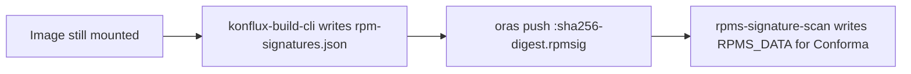

# 72. Scan RPM signatures from a build-time artifact

Date: 2026-10-08

## Status

Proposed

## Context

`rpms-signature-scan` reports installed RPM signatures (`rpm -qa`) as task results for Conforma to evaluate later.

Today the task gets that inventory by pulling the image the build just pushed, unpacking its layers, and querying the rpmdb again. The build already had that filesystem mounted. Repeating the extract is expensive (CPU, memory, disk, wall time), and it grows with image size and with every architecture in a matrix.

`rpm -qa` itself is cheap if it runs while the image is still mounted. The expensive part is reconstructing the filesystem later from the registry.

This ADR does **not** use the SBOM, Syft, Hermeto, Mobster, or Cosign attach. RPM signature data is a separate sibling OCI artifact, found from the same `IMAGE_URL` and `IMAGE_DIGEST` the scan already has.

## Decision

After `image build` mounts the output image, `konflux-build-cli` runs `rpm -qa` against that mount and writes `rpm-signatures.json`. After the image is pushed, it `oras push`es that file next to the image, using a sibling tag derived from the **child** digest:

`{repo}:sha256-<digest>.rpmsig`

with `--artifact-type application/vnd.konflux.rpmsig`. The digest in the tag is the per-architecture image, not a multi-arch index. An index has no rpmdb of its own, so it has no `.rpmsig`. Each architecture child does.

Writing and pushing are best-effort so **`image build` still succeeds regardless of RPM signatures**, same as today. Unsigned RPMs are not a build failure. A failed query writes `{"reason": "..."}` and continues. A failed `oras push` is logged and continues (nothing can be published if push itself failed). Collection does not depend on SBOM generation or `SKIP_SBOM_GENERATION`.

`rpms-signature-scan` no longer pulls the image. It uses `IMAGE_URL` and `IMAGE_DIGEST`; if that digest is an index it walks the children, then pulls `{repo}:sha256-<child>.rpmsig` for each. From that JSON it produces the **same results as today** (`TEST_OUTPUT`, `RPMS_DATA`, `IMAGES_PROCESSED`, `SCAN_LOG`) for Conforma:

- Package list → `RPMS_DATA` `keys` (per-key counts plus `unsigned`). Task `SUCCESS`. Conforma decides if unsigned RPMs fail the pipeline.
- `no RPM database in image` / `RPM database is empty` → `unsigned` 0, task `SUCCESS`.
- `rpm not found in PATH` / `rpm -qa failed: …` → same as today's `rpm -qa` `CalledProcessError`: `RPMS_DATA` `{"error": "<reason>"}`, `TEST_OUTPUT` `ERROR`, verifier exits non-zero.
- Missing `.rpmsig` → `{"error": "..."}` and `ERROR`, same as a failed extract today.

### JSON (`rpm-signatures.json`)

The file is either a package list or a reason, not both.

**Success** — one object per installed RPM (`gpg-pubkey` rows are skipped). `name` is NEVRA (`NAME-[EPOCH:]VERSION-RELEASE.ARCH`). `pgp_key_id` is the hex PGP key ID from the RPM header, or `unsigned` if there is no signature:

```json
{
  "packages": [
    {"name": "bash-5.2.26-6.el10.x86_64", "pgp_key_id": "199e2f91fd431d51"}
  ]
}
```

**No packages to judge, or the query could not run** — `packages` is omitted:

```json
{"reason": "no RPM database in image"}
```

| `reason` | Meaning | Task / `RPMS_DATA` |
|---|---|---|
| `no RPM database in image` | No rpmdb files in the mount | `SUCCESS`, `unsigned` 0 |
| `RPM database is empty` | rpmdb present but no installed packages | `SUCCESS`, `unsigned` 0 |
| `rpm not found in PATH` | Host `rpm` binary missing | `ERROR`, `{"error": "…"}` |
| `rpm -qa failed: …` | Query error (stderr included) | `ERROR`, `{"error": "…"}` (same shape as today's `rpm -qa` stderr) |

### Work order

1. **konflux-build-cli** — collect while mounted; push `.rpmsig` after the image.
2. **buildah** (container-build-catalog) — pass `--rpm-signatures-output` in the existing image-build script. No new Tekton task parameter; pipelines keep using `IMAGE_URL` / `IMAGE_DIGEST`.
3. **tools image** — `rpm_verifier` pulls `.rpmsig` per child digest instead of extracting the image.
4. **Bump `rpms-signature-scan`** so pipelines pick up that tools image ([ADR 0054](0054-task-versioning.md)). Until this bump, the scan still extracts the image.



## Alternatives Considered

**Keep extracting the image.** Accuracy would stay the same, but every scan would still pay for a full pull and unpack. That is the cost this ADR removes.

**Stamp the SBOM.** The SBOM describes components Syft (and Hermeto) found. RPM PGP key IDs from `rpm -qa` are not SBOM fields, and stuffing them there uses the document as a side channel.

Two places were considered and both are wrong:

- **Image package** — that row describes the container image, not the installed RPMs. Putting the whole inventory there hides which RPM is unsigned.
- **Each Syft `pkg:rpm` row** — join is lossy (NEVRA vs purl). RPMs that do not match a Syft row disappear. If the RPM cataloger is disabled, or `SKIP_SBOM` is set, there are no Syft RPM packages at all, so there is nothing to attach to — while the image can still contain an rpmdb that must be judged.

Rejected.

## Consequences

The scan is a small registry fetch of `.rpmsig` instead of an image pull and unpack. Large and multi-arch builds spend less time and memory. Conforma still consumes `RPMS_DATA` as it does today. The scan no longer depends on SBOM generation. Image-controller garbage collection of `.rpmsig` tags when the image is removed is a follow-up.
