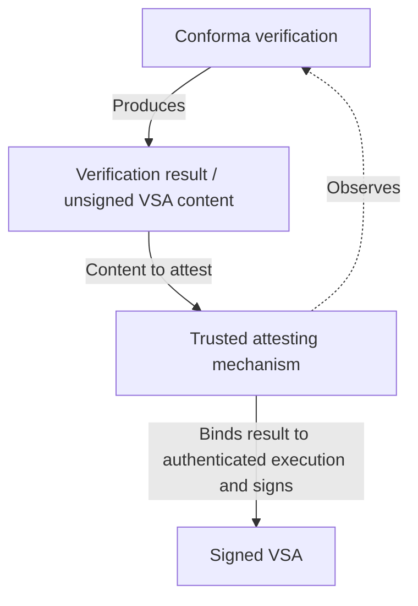
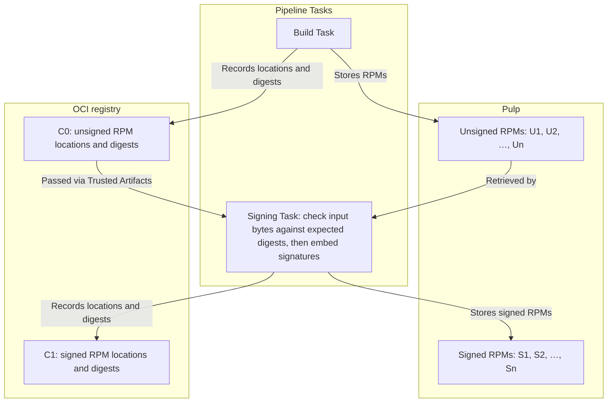
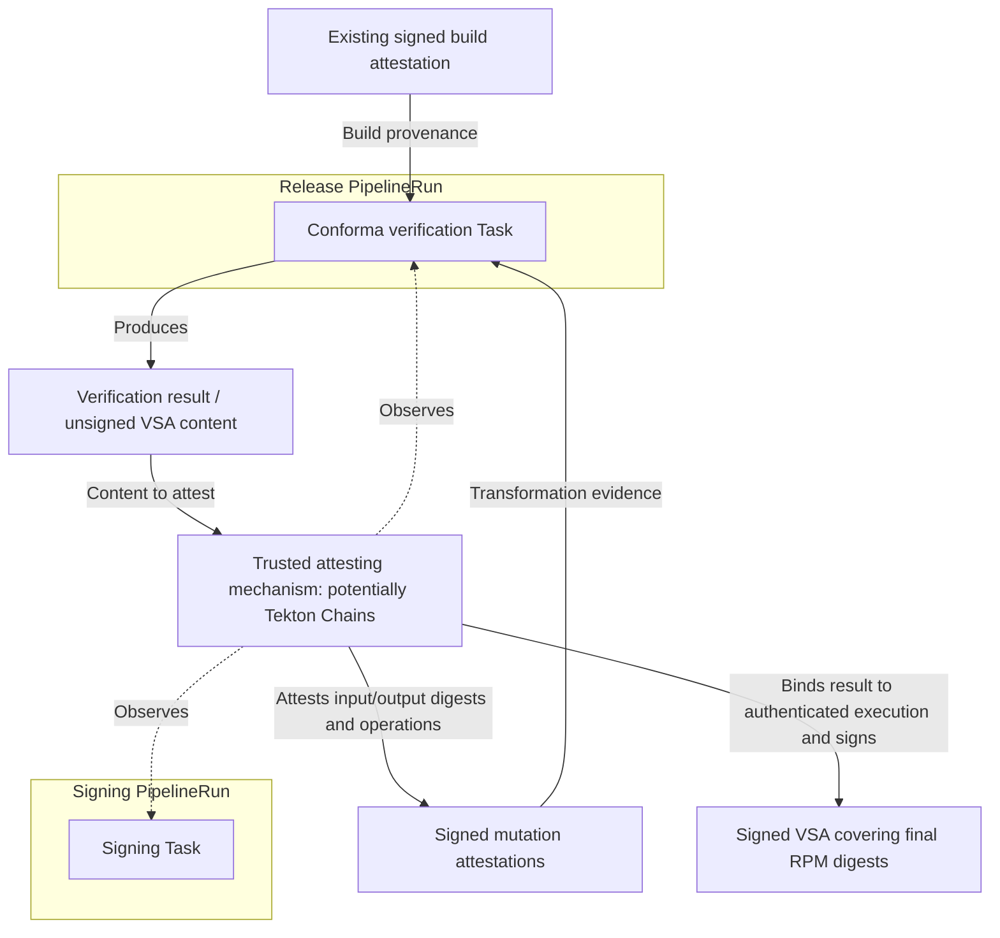

# 74. Preserving provenance across post-build artifact transformations

Date: 2026-10-22

## Status

Proposed

## Context

Some artifacts must be transformed after their build completes. Examples include embedding SBOM content in Python wheels or Maven JARs, signing RPMs, and applying platform signatures to Windows or macOS binaries.

These operations change the artifact bytes and therefore its digest. The final distributable artifact is no longer the subject identified by the original build provenance. We need evidence that authenticates the relationship between the build output and each subsequent transformed artifact.

Artifacts may also be stored outside an OCI registry. For example, an OCI artifact could contain a metadata file listing the locations and checksums of several RPMs held in an external artifact store. Moving those RPMs between storage locations could replace the metadata or invalidate historical download locations. Storage pointers and checksum fields are not sufficient on their own: trusted evidence must authenticate the checksums and their relationship to the build or transformation outputs.

Two distinct verification needs follow:

1. Konflux must retain evidence allowing an independent verifier, given that evidence, to authenticate the transformation chain.
2. Customers must be able to verify the final distributable artifact without understanding Konflux’s internal storage metadata or retrieving every historical artifact.

A Verification Summary Attestation (VSA) supports the second need by recording a trusted verifier’s result against an identified policy. It does not, by itself, describe a transformation between artifacts. Separate VSAs for two artifacts do not establish that one was produced from the other.

[ADR-0049](https://github.com/konflux-ci/architecture/blob/main/ADR/0049-vsa-support.md) adopts VSAs as inputs to release-policy checks. This decision complements that approach by defining the evidence needed across transformations and the relationship between that evidence and final-artifact VSAs.

[ADR-0066](https://github.com/konflux-ci/architecture/blob/main/ADR/0066-ecosystem-native-distribution.md) defines ecosystem-native distribution of non-OCI artifacts and their supply chain metadata. This decision defines the evidence that must survive transformations; it does not replace those distribution requirements.

## Decision

Konflux will preserve provenance across authorised post-build transformations by ensuring each transformation consumes inputs identified by trusted predecessor evidence and retaining signed mutation attestations that bind its output digests to its input digests and the operation performed.

Where customer verification would otherwise require internal storage metadata, Konflux will also produce and retain a signed VSA covering the final distributable artifact digest. Customers who trust that verifier and accept its policy may rely on the VSA without walking the underlying transformation chain themselves.

### 1. Artifact identity and mutation evidence

Artifacts are identified by their digests, not by their download locations.

For each mutation, Konflux must produce a signed attestation that:

- Identifies the output artifact digest as a subject.
- Identifies all input artifact digests for the recorded transformation.
- Identifies the operation performed.
- Provides sufficient context to evaluate whether the attesting identity was authorised to assert that transformation.

The original build provenance and the mutation attestations must authenticate a chain from the final artifact digest back to the artifact digest identified by trusted build provenance.

One attestation may cover multiple transformation outputs, provided the relationships between inputs, outputs and operations remain unambiguous. For example, a batch-signing attestation may cover `U1 → S1` and `U2 → S2` if it identifies those input/output pairings and records that signing was performed for each pair. Where those relationships cannot be recorded unambiguously, the implementation must use separate attestations. Grouping must not imply that an operation applied to an artifact when it did not.

An OCI reference representing a collection is a distinct artifact in its own right; the individual artifacts it references are not interchangeable with it. For example, an OCI artifact may anchor metadata listing several RPM digests stored in Pulp; the anchor digest is distinct from each RPM’s digest. Where individual artifacts are mutated, the evidence must identify their digests and authenticate their relationship to the collection.

### 2. Input integrity during mutation

Before executing a mutation, the pipeline must:

1. Obtain the expected input digests from the approved predecessor dataflow and evidence.
2. Check that the actual input bytes match those digests.
3. Ensure the exact bytes checked are the bytes consumed by the mutation.

The pipeline must not execute the mutation if an input digest or byte-binding check fails. These checks establish input integrity; they do not require the mutation Task to verify the full provenance chain or decide whether the artifact satisfies release policy.

The implementation must preserve the input-digest relationship through execution. The mutation attestation must identify the resulting output bytes, rather than merely an intended destination or a workload-reported checksum.

Inter-Task file transfer must use OCI-backed Trusted Artifacts as defined by [ADR-0036](https://github.com/konflux-ci/architecture/blob/main/ADR/0036-trusted-artifacts.md), rather than general-purpose shared workspaces. Conforma's release-gate verification must cover the mutation attestations and the input/output wiring of approved mutation Tasks. Where a transformation’s input/output relationship is not established through Trusted Artifacts and the approved Task path, the implementation must explain how it authenticates that relationship.

### 3. Attesting identities and trust

Mutation attestations and VSAs make different assertions:

- A **mutation attestor** authenticates that an identified operation produced the stated outputs from the stated inputs.
- A **verifier** asserts that identified artifacts and evidence satisfied an identified policy.

Trust policy must authorise identities for their respective roles. A valid signature alone does not establish that authority.

The mutation-attestor and verifier roles do not require separate keys or services, but their authority and enforcement boundaries must be explicit.

The mutation workload must not be able to make its output trusted merely by declaring success or supplying an attestation to a signing interface that will sign whatever it is given. The attestation mechanism must obtain trustworthy evidence of the execution and its input/output relationship.

Mutation evidence must build on the existing Trusted Artifacts and approved Task-path controls, using authenticated execution records and input/output digest bindings. Task approval uses the existing Trusted Tasks model described in [ADR-0053](https://github.com/konflux-ci/architecture/blob/main/ADR/0053-trusted-task-model.md); it does not by itself establish that a particular execution performed the recorded transformation.

Trusted Artifacts protect inter-Task transfer integrity; they do not by themselves constitute signed mutation evidence. The attestor design must explain how these controls establish the recorded transformation, and identify the controls covering any relationship not established through Trusted Artifacts and the approved Task path. Where the existing controls provide the necessary evidence, no separate execution observer or parallel trust or release-policy model is required.

Tekton Chains deep inspection of type-hinted TaskRun results is one candidate for discovering mutation inputs and outputs and producing attestations. This decision does not mandate Chains, and any implementation using it must still show how the attestation is bound to the actual input and output bytes and to authorised execution; discovering TaskRun results alone does not establish those facts.

The concrete mutation-attesting identity and its execution-authentication mechanism remain implementation decisions that must be resolved before implementation can proceed.

### 4. Verification summaries

A VSA summarises verification; it does not replace mutation evidence.

Mutation evidence establishes artifact lineage, not that a mutation preserves every property previously verified for its input. Applicable Conforma release policy determines whether the transformed artifact satisfies release requirements, including any required embedded SBOM or signature, and which checks remain valid after the recorded operations.

Before authorising release, Conforma must establish that the candidate artifacts satisfy the applicable provenance-chain requirements and release policy. These requirements cover each candidate artifact's digest, its chain of mutation attestations back to trusted build provenance, attestation signatures, authorisation of attesting identities, input/output digest links and the recorded operations. Conforma may establish satisfaction of these requirements by verifying the underlying evidence directly or by accepting signed VSAs where the applicable policy permits reliance on their verifier, scope and verification results. Reliance on a VSA does not remove the requirement to retain the underlying evidence.

A release-policy decision may cover one artifact or several explicitly identified artifacts. It must cover the final transformed digests being released, not merely their pre-transformation predecessors. This decision does not require a separate release-policy check between mutations. Mutation Tasks perform the input-integrity checks described in §2, rather than full-chain or release-policy verification.

Where establishing the final artifact’s provenance would otherwise require interpreting storage-specific metadata, Konflux must produce and retain a signed VSA that:

- Identifies the final distributable artifact digest as a subject.
- Identifies the verifier and policy applied.
- Records successful verification of the applicable provenance-chain requirements.
- Is signed by an identity trusted for that verification role.

Conforma, running in a pipeline Task, is one candidate for performing the verification and generating the VSA content. A trusted attesting mechanism must bind that content to the authenticated verification execution and sign it. This is an implementation option, not a claim about current Conforma support for mutation-chain verification; this decision does not mandate a particular verification or attestation implementation.

In the diagram below, the dashed arrow represents the attesting mechanism observing or authenticating the verification execution, not merely receiving its reported result. The attesting mechanism binds the VSA content to that execution before signing it.



A VSA covering an unsigned artifact does not cover its signed replacement.

A VSA’s verification result applies to its explicitly identified subject digests. Identifying an OCI artifact as a subject does not automatically make the artifacts it references subjects of that VSA.

Where this decision requires a customer-verifiable VSA, it must explicitly identify the final distributable artifact digests. For example, a VSA intended to support verification of downloaded RPMs must identify those RPM digests, not merely the digest of an OCI artifact containing their storage metadata. One VSA may cover several explicitly identified artifacts; separate per-artifact VSAs are also permitted. VSAs covering the OCI artifact itself are permitted but are not additionally required by this decision.

This decision does not require an additional VSA if the retained attestations already allow customers to verify the provenance chain without interpreting storage-specific metadata. Existing release-policy requirements from ADR-0049 continue to apply.

### 5. Evidence retention and storage independence

Konflux must retain the original build provenance and the authenticated evidence needed to verify each subsequent transformation.

Verification of recorded lineage must not depend on retrieving original or intermediate artifact bytes from their historical storage locations. Those bytes may be garbage-collected while the required evidence is retained.

Checks that require the original or intermediate artifact bytes may no longer be possible after those bytes have been deleted.

Storage locations may assist retrieval, but must not be treated as artifact identity or as substitutes for authenticated relationships.

### 6. Simple example: updating an embedded SBOM and signing a JAR

A build produces a JAR containing an SBOM. Its signed build provenance identifies the JAR's digest, `A`, and records how it was built. Before distribution, two operations change its bytes:

1. Updating the embedded SBOM's purls to point to the actual release locations produces a JAR with digest `B`.
2. Signing that JAR embeds signature data, producing the final distributable JAR with digest `C`.

A customer receives `C` and wants assurance that it came from the recorded build. The build provenance identifies `A`, not `C`. The JAR signature authenticates its signer, but does not establish the relationship to `A`.

This decision requires signed mutation evidence for both transformations:

- **SBOM augmentation:** identifies `B` as its subject, `A` as an input, and updating the embedded SBOM's release-location purls as the operation. It also identifies any artifact inputs supplying the release-location mapping.
- **JAR signing:** identifies `C` as its subject, `B` as its input, and JAR signing as the operation.

Before each transformation, the pipeline checks that the input bytes match the expected digests and ensures those exact bytes are consumed. Authorised attestors authenticate the operations and their input/output relationships. A verifier can then follow the evidence backwards:

```text
Final distributable JAR C
    ↓ signing attestation: B → C
JAR B with updated SBOM purls
    ↓ SBOM-augmentation attestation: A → B
Original JAR A with embedded SBOM
    ↓ build provenance
Recorded source and build process
```

Before authorising release of `C`, Conforma establishes that this chain and the final artifact satisfy the applicable release policy. Further transformations can extend the chain using the same mechanism. The recorded lineage remains verifiable from retained evidence even if the original and intermediate JAR bytes are deleted.

A signed VSA covering `C` can let customers who trust its verifier and accept its policy rely on that verification result instead of examining the chain themselves. Konflux still retains the build provenance and mutation evidence supporting the result.

### 7. Multiple RPMs behind an OCI reference

The same principle applies when an OCI metadata artifact represents several RPMs stored elsewhere. Additional evidence must authenticate which RPM digests that metadata represents.

In this hypothetical example, a build produces several unsigned RPMs stored in Pulp. An OCI artifact contains metadata listing their locations and digests. This example calls it the OCI metadata artifact. Signing embeds a signature in each RPM, changing its bytes and digest, so signing is a mutation.

OCI-backed Trusted Artifacts carry the metadata between approved Tasks, while the RPM bytes remain in Pulp. Trusted evidence must authenticate the RPM digests listed in that metadata.

Before signing, the signing Task checks the retrieved RPM bytes against those digests. Mutation attestations then record the relationship between each unsigned RPM and its signed output.



The evidence must establish the following relationships:

1. **Build to unsigned RPMs.** Trusted predecessor evidence (in this case, the build attestation) authenticates each unsigned RPM checksum. The retrieved RPM bytes are checked against that checksum.
2. **Unsigned to signed RPMs.** Mutation attestations authenticate the signing operation and the relationship between each unsigned RPM and its signed output.
3. **OCI metadata artifacts to RPMs.** Trusted evidence authenticates the association between each relevant OCI metadata artifact and the RPM digests it represents.

For example, a mutation attestation may identify `S1` as its subject, `U1` as an input and RPM signing as the operation. The same principle applies to every RPM transformed in the collection.

Links between the OCI metadata artifact and RPMs in Pulp help locate the files, but do not prove that those files are the build or signing outputs. Trusted evidence must authenticate the recorded digests, and the retrieved RPM bytes must match them.

After verifying these relationships and the applicable policy, Konflux can produce a VSA for each final signed RPM, or one VSA explicitly covering several final signed RPM digests. Where §4 requires customer-verifiable VSAs, these provide the required coverage.

Konflux may also produce a VSA covering the OCI metadata artifact itself.

The diagram below shows the evidence and verification flow after the signed build attestation has been created. It illustrates signing and release in separate PipelineRuns, with a shared trusted attesting mechanism. Tekton Chains is a candidate for this mechanism if it can meet the execution-authentication and digest-binding requirements in §3. The dashed arrows represent observation or authentication of execution.

Conforma's verification includes the authenticated OCI-to-RPM bindings described above and may rely on acceptable VSAs as described in §4; these inputs are omitted from the diagram for clarity.



A customer holding RPM `S1` can hash it and verify an acceptable VSA covering that digest. The customer need not interpret the storage-specific metadata, retrieve `U1`, or walk the internal evidence chain.

### Alternatives considered

#### Treat the original build provenance as covering the transformed artifact

Rejected. The transformed bytes have a different digest. Reusing the original provenance without authenticated transformation evidence would misrepresent its subject.

#### Retain only successive VSAs

Rejected. VSAs can support delegated verification, but separate verification results do not establish an input/output relationship. Underlying mutation evidence must be retained.

#### Require a newly generated VSA before every mutation

Rejected as a universal requirement. Mutation Tasks must perform the input-integrity checks described in §2, but need not perform full release-policy verification or obtain a fresh VSA before each mutation.

#### Rely on storage history and checksum pointers

Rejected as sufficient evidence on their own. They become useful integrity links only when trusted evidence authenticates the relevant checksums and relationships.

#### Require permanent retention of all historical artifact bytes

Rejected as a prerequisite for lineage verification. Retained authenticated evidence can establish the recorded chain without those bytes. Retention for reproduction or repeated byte-dependent checks is a separate concern.

## Consequences

### Benefits

- Authorised post-build changes no longer break the recorded provenance chain.
- Artifact identity and lineage remain verifiable despite changes to storage locations.
- Customers can rely on final-artifact verification without understanding internal storage metadata.
- The same model supports individual artifacts and collections represented by an OCI metadata artifact.
- Mutation evidence and verification summaries have distinct, explicit meanings.

### Costs and constraints

- Mutation paths become dependent on successful input verification and evidence availability.
- Attestation schemas, attesting identities, trust policies and retention arrangements require ongoing maintenance and security review.
- The attestation mechanism must authenticate execution rather than merely sign workload assertions.
- A final-artifact VSA delegates trust to its verifier and policy; it does not eliminate that trust dependency.
- Garbage-collecting artifact bytes may prevent repeated byte-dependent checks even when lineage remains verifiable.
- Supporting RPMs requires authenticated OCI-to-RPM bindings beyond ordinary storage pointers.

### Remaining design work

Before an implementation can proceed, its design must identify:

- The supported content types and mutation operations.
- The mutation-attestation schema and representation of predecessor relationships.
- The mutation-attesting identity and how authenticated execution records and digest bindings support its assertions, using the existing controls or equivalent controls where required.
- Whether Tekton Chains deep inspection of type-hinted TaskRun results can meet these requirements, or what alternative attestation mechanism to use.
- How Conforma establishes satisfaction of the provenance-chain requirements and applicable release policy, including when it may rely on signed VSAs.
- Evidence storage, retention and retrieval arrangements.
- Any required VSA-generation integration.

These choices must satisfy this decision without introducing a parallel release-policy model or relying on manually maintained per-artifact mappings.
